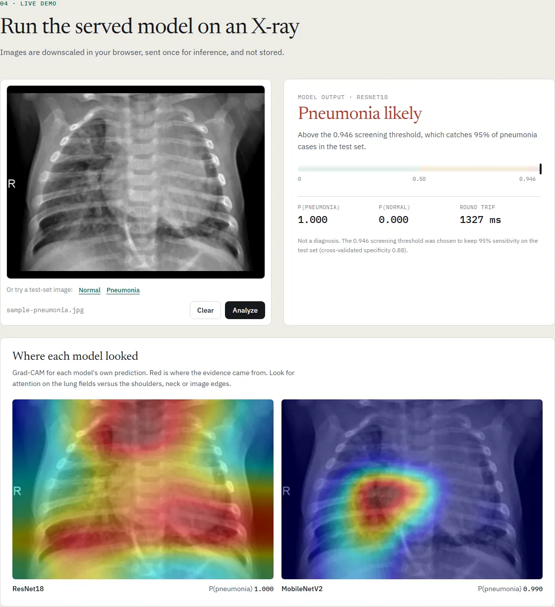
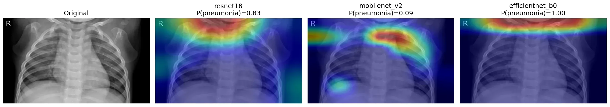

# PneumoScan: accuracy vs. attention in pediatric chest X-ray CNNs

[](https://pneumoscan-nine.vercel.app)
[](https://pneumoscan-nine.vercel.app/project_summary.pdf)


**Try it: [pneumoscan-nine.vercel.app](https://pneumoscan-nine.vercel.app)**. Upload a chest X-ray (or click a sample) and see where ResNet18 and MobileNetV2 look, side by side.

[](https://pneumoscan-nine.vercel.app/#demo)

Three ImageNet-pretrained CNNs (ResNet18, MobileNetV2, EfficientNet-B0) fine-tuned to detect pneumonia in pediatric chest X-rays. The most accurate one, ResNet18, puts barely more of its Grad-CAM attention on the lungs than chance would. MobileNetV2 is 2.2 points less accurate and puts 71% there. On an external adult dataset, every model loses about 0.2 AUC, and ResNet18's in-distribution lead disappears.

> Research demonstration only. Not a medical device and not for clinical use.



*A normal X-ray. ResNet18 calls it pneumonia (P = 0.83) with attention on the neck and upper mediastinum. MobileNetV2 correctly calls it normal (P = 0.09).*

## Results

### 1. In-distribution (Kermany et al. test split, n = 624)

| Model | Accuracy | F1 | AUC (95% CI) | Sensitivity | Specificity |
| :--- | :---: | :---: | :---: | :---: | :---: |
| ResNet18 (served) | **87.8%** | **0.911** | **0.978** (0.967–0.987) | 0.997 | 0.679 |
| MobileNetV2 (served) | 85.6% | 0.896 | 0.968 (0.953–0.980) | 0.995 | 0.624 |
| EfficientNet-B0 | 84.8% | 0.891 | 0.951 (0.933–0.968) | 0.997 | 0.598 |

Threshold 0.5. ResNet18's AUC lead over MobileNetV2 is small but significant (paired bootstrap: −0.011, 95% CI −0.019 to −0.003).

**Operating point.** At 0.5 all three flag about a third of healthy children. Choosing the threshold for 95% sensitivity (stratified 2-fold CV, 50 splits) gives:

| Model | Threshold | Sensitivity | Specificity |
| :--- | :---: | :---: | :---: |
| ResNet18 | 0.946 | 0.949 ± 0.021 | **0.882 ± 0.024** |
| MobileNetV2 | 0.951 | 0.948 ± 0.025 | 0.863 ± 0.032 |
| EfficientNet-B0 | 0.992 | 0.950 ± 0.020 | 0.790 ± 0.030 |

The demo uses ResNet18 at 0.946.

### 2. Where the models look

For each test image, torchxrayvision's ChestX-Det PSPNet segments the lungs, clavicles and scapulae. We measure the share of Grad-CAM energy (last conv block, predicted class) that falls inside each mask. If attention were spread at random, the lung share would equal the lung's share of the image (the "chance" column).

**Normal X-rays** (masks are reliable here; on pneumonia X-rays the adult-trained segmenter drops some consolidated lung):

| Model | Pediatric: on lungs (95% CI) | Pediatric: peak in lung | Adult NIH: on lungs (95% CI) |
| :--- | :---: | :---: | :---: |
| *chance (lung area)* | *38.5%* | | *33.4%* |
| ResNet18 | 43.9% (42.8–45.0) | 21% | 38.7% (36.8–40.6) |
| MobileNetV2 | **71.2%** (70.1–72.3) | **60%** | **58.2%** (56.3–60.0) |
| EfficientNet-B0 | 40.7% (38.1–43.4) | 33% | 16.4% (14.1–19.0) |

MobileNetV2 − ResNet18: **+27.3 points** (pediatric, CI +26.0 to +28.6) and +19.6 (NIH, CI +18.1 to +21.0). On pediatric pneumonia X-rays the gap is +30.6.

A correction to this project's original claim. By eye, ResNet18 seemed to focus on the shoulders. Measured, its attention on clavicles and scapulae (4.7%) is below their 6.4% share of the image. Its attention isn't on the shoulders; it's spread over the neck, mediastinum and image borders, and mostly not on the lungs.

### 3. External test (NIH ChestX-ray14, adult, n = 656)

Batch 7 of NIH ChestX-ray14, restricted to images with radiologist-adjudicated labels from Majkowska et al. (Radiology, 2020): 364 *airspace opacity*, 292 with all four expert labels negative. Mostly AP views.

| Model | Pediatric AUC | NIH AUC (95% CI) | Drop (95% CI) |
| :--- | :---: | :---: | :---: |
| ResNet18 | 0.978 | 0.772 (0.735–0.808) | −0.206 (−0.246 to −0.170) |
| MobileNetV2 | 0.968 | **0.786** (0.753–0.819) | **−0.181** (−0.217 to −0.146) |
| EfficientNet-B0 | 0.951 | 0.733 (0.695–0.771) | −0.218 (−0.259 to −0.178) |

- ResNet18's lead vanishes. MobileNetV2 ranks first, but MobileNetV2 − ResNet18 = +0.015 (CI −0.020 to +0.051) is not significant, and neither is the difference in drops (+0.025, CI −0.011 to +0.063).
- The pediatric threshold doesn't transfer. At 0.946, ResNet18 flags 80% of healthy adults (specificity 0.199).
- Takeaway: lung-focused attention didn't produce measurable robustness under this shift, which mixes a new hospital with a new age group. It still makes MobileNetV2 the only model whose evidence can be checked against anatomy.

Raw outputs: [`results/`](results) (per-image probabilities, per-image attention scores, AUC bootstrap).

## Live demo: [pneumoscan-nine.vercel.app](https://pneumoscan-nine.vercel.app)

- Upload an X-ray, or click a bundled test-set sample.
- Both served models return P(pneumonia) and a Grad-CAM overlay, shown side by side.
- The heatmaps are exact Grad-CAM at no extra cost. All three heads are global-average-pool → linear, so Grad-CAM on the last conv block equals the class activation map `Σ_k W[c,k]·A_k`. The ONNX graphs output it directly (verified correlation = 1.0 against autograd Grad-CAM).
- Uploads are downscaled in the browser to stay under Vercel's 4.5 MB request limit.

## Stack

- **Serving:** FastAPI + ONNX Runtime (CPU) as a Vercel Python function. NumPy/Pillow preprocessing identical to training: grayscale → 3 channels → 224×224 bilinear → ImageNet normalisation.
- **Frontend:** static HTML/CSS/JS in `public/`, served from Vercel's CDN, with light and dark themes.
- **Tests:** a Playwright end-to-end test (desktop and mobile). It uploads the samples, checks the verdicts and heatmaps, and checks for horizontal overflow and JS errors.

## Reproduce

```bash
python -m venv venv && venv\Scripts\activate          # or: source venv/bin/activate
pip install -r requirements.txt                        # serving only
pip install torch torchvision --index-url https://download.pytorch.org/whl/cpu
pip install torchxrayvision scipy pandas playwright pytest && playwright install chromium
```

| Step | Command |
| :--- | :--- |
| Train (Kaggle T4, ~10 epochs/model) | [`notebooks/chest-x-ray.ipynb`](notebooks/chest-x-ray.ipynb) |
| Export to ONNX + metrics + operating point | `python scripts/export_onnx.py resnet18_best.pth --arch resnet18 --test-dir chest_xray/test --probs-csv results/kermany_resnet18.csv` |
| Build NIH external set | download `images_007.tar.gz` from the [NIH Box](https://nihcc.app.box.com/v/ChestXray-NIHCC), extract, then `python scripts/prepare_nih.py images nih_test` |
| AUC comparison (paired bootstrap) | `python scripts/compare_auc.py results` |
| Attention analysis | `python scripts/gradcam_overlap.py --weights-dir <dir with *_best.pth> --test-dir chest_xray/test --out results/kermany` |
| Summary PDF (from `docs/summary.html`) | `python scripts/make_summary_pdf.py` |
| Run locally | `uvicorn main:app --port 8000` |
| End-to-end test | `pytest tests` (or `BASE_URL=https://pneumoscan-nine.vercel.app pytest tests`) |

Pushes to `main` deploy to Vercel automatically at **https://pneumoscan-nine.vercel.app**.

## Limitations

- **One training run per model.** Accuracy gaps of 1–3 points between models may be partly seed noise.
- **The external test confounds two shifts:** a different hospital and adults instead of children (and mostly AP views).
- **Lung masks come from a model trained on adults,** not radiologist annotation. It undercounts consolidated lung on pediatric pneumonia X-rays, which is why normal X-rays are the primary comparison.
- **The validation split is 16 images.** Operating points were chosen by cross-validation on the test set, so they're optimistic for a truly new site, as the NIH result shows.
- **Not a medical device.** No FDA or CE clearance.

## Data and citations

- Kermany D.S. et al., "Identifying Medical Diagnoses and Treatable Diseases by Image-Based Deep Learning," *Cell* 172(5), 2018.
- Wang X. et al., "ChestX-ray8," CVPR 2017 (NIH ChestX-ray14).
- Majkowska A. et al., "Chest Radiograph Interpretation with Deep Learning Models," *Radiology* 294(2), 2020 (expert labels).
- Cohen J.P. et al., "TorchXRayVision," MIDL 2022 (segmentation model).
